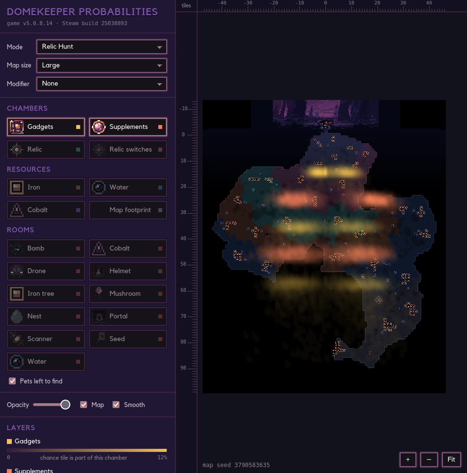

# Domekeeper Probabilities

[Live app here!](https://evidlo.github.io/domekeeper)

Probability maps of where things spawn in Dome Keeper maps: gadget, supplement and relic
chambers, resources, and rooms (caves), per game mode.  3000 maps were generated per mode from game sources and the locations of these object saved and plotted.

This repository contains only analysis code, game stubs and viewer HTML, no game source code:

